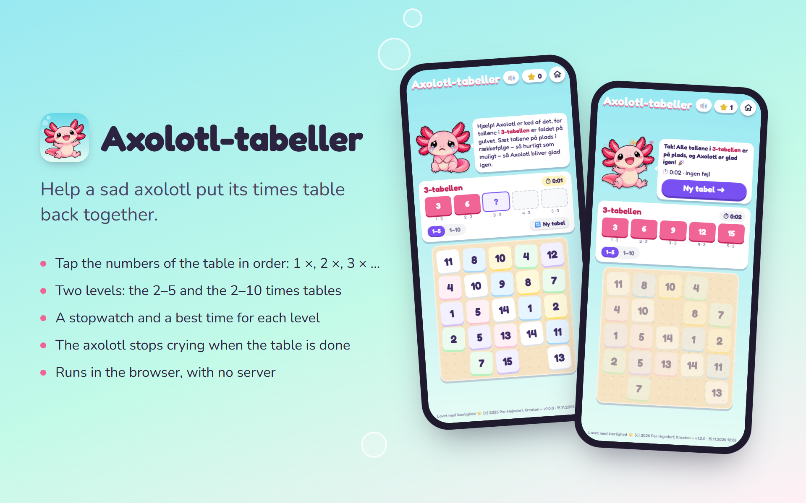

# Axolotl-tabeller (AxolotlTables)




**A times-table game for kids.**

Axolotl is crying: all the numbers in one of its times tables have fallen on the floor. The child finds the numbers among 25 tiles and taps them in order, 1 × first, then 2 ×, 3 × and so on, as fast as possible. Each right number jumps into its place with a pling, and a wrong one shakes with a short "bonk". When the table is complete, Axolotl is happy again, a fanfare plays and the child earns a star.

**Play it:** <https://kreaton.github.io/KidsGames/axolotltables/>

It is a Blazor WebAssembly app (.NET 10) that runs entirely in the browser, with no server or backend. It can be pinned to the home screen on phones and tablets and then runs full screen like an app. The game is in Danish.

## How it plays

1. A table is picked, and Axolotl asks for help: *"Hjælp! Axolotl er ked af det, for tallene i 3-tabellen er faldet på gulvet …"*, with a sad fanfare.
2. Above the floor is a row of empty places, one for each number in the table, marked 1 · 3, 2 · 3, 3 · 3 … The next place to fill pulses with a "?".
3. The child taps the numbers on the floor in order. The stopwatch starts at the first tap, so reading the story is free.
4. With the last number in place Axolotl hops with joy, and the time and the number of mistakes are shown, with "Ny rekord!" for a new best time.

## Levels

| Level | Tables   | Places | Example (the 3 table)        |
|-------|----------|--------|------------------------------|
| 1–5   | 2 – 5    | 5      | 3, 6, 9, 12, 15              |
| 1–10  | 2 – 10   | 10     | 3, 6, 9, … 30                |

- The same table never comes twice in a row. The 1 table is left out: every number up to its end is in it, so there would be nothing else to put on the floor.
- The 5 × 5 floor holds each number in the table exactly once. The other tiles are fillers that are *not* in the table and never bigger than its last number, so a number can't be ruled out just for being too big. The fillers are all different when there are enough of them; the 2 table on level 1 only has 1, 3, 5, 7 and 9, so they repeat.

The rules are in [`Game/TableGame.cs`](src/AxolotlTables/Game/TableGame.cs).

## Features

- Big, touch-friendly tiles that work in portrait and landscape
- A crying axolotl that turns happy when the table is done; tap it to hear it again
- Stopwatch, star counter, and a best time per level kept in the browser (`localStorage`), as is the chosen level
- Sounds synthesized with the Web Audio API in [`wwwroot/js/sounds.js`](src/AxolotlTables/wwwroot/js/sounds.js), so there are no audio files; a 🔊/🔇 button turns them off
- Web app manifest and Apple touch icons for "Add to Home Screen"
- An "Alle spil" button back to the [KidsGames](https://kreaton.github.io/KidsGames/) front page

## Project layout

```
AxolotlTables.slnx
art/                          The happy and sad axolotl, cut from the original drawing (transparent PNG)
images/banner.png             The picture at the top of this README
src/AxolotlTables/
  Game/TableGame.cs           Picks the table, lays out the floor and checks each tap
  Pages/Home.razor            The game screen
  Layout/MainLayout.razor
  wwwroot/
    index.html                Host page, home-screen meta tags, <base href>
    css/app.css               All styling and animations
    js/sounds.js              Sad fanfare, happy fanfare, pling and bonk
    images/                   The two axolotls as WebP for the game
    manifest.webmanifest
    icons/                    App icons and favicon
tools/make-icons.ps1          Draws the icons from art/axolotl-happy.png (and copies icon-512.png to KidsGames/billeder/axolotltables.png)
```

## Running locally

Requires the [.NET 10 SDK](https://dotnet.microsoft.com/download).

```bash
dotnet run --project src/AxolotlTables
```

Then open http://localhost:5341 (or https://localhost:7341 with the `https` launch profile). You can also open `AxolotlTables.slnx` in Visual Studio and press F5.

## Publishing

Pushing to `main` builds the app and puts it in the `axolotltables/` folder of the KidsGames GitHub Pages site (<https://kreaton.github.io/KidsGames/axolotltables/>) with [`.github/workflows/deploy.yml`](.github/workflows/deploy.yml). The run number becomes the patch version (1.0.*run*), shown at the bottom of the game. It needs the repository secret `PAGES_DEPLOY_KEY`: the private half of a deploy key with write access to `kreaton/KidsGames`.

To publish by hand:

```bash
dotnet publish src/AxolotlTables -c Release -o src/AxolotlTables/bin/Publish
```

and copy the contents of `bin/Publish/wwwroot` to any static web host.

The app is set up to be served from an `axolotltables` sub-path: `<base href>` in [`wwwroot/index.html`](src/AxolotlTables/wwwroot/index.html) is `axolotltables`. Change it if you host the app somewhere else, for example `/` for the site root.

## License

[MIT](LICENSE)
